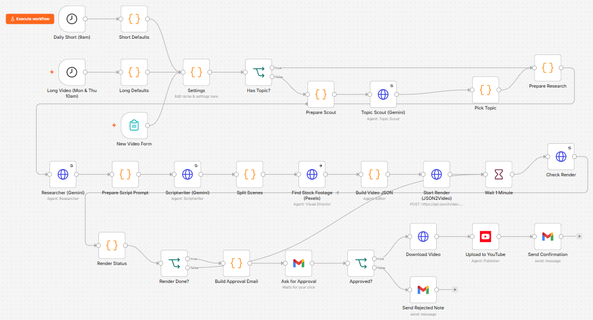
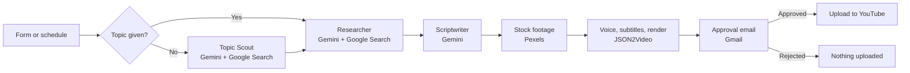

# AI YouTube Video Agent Team

A team of AI agents built with **n8n** that produces complete YouTube videos: it picks a topic, researches it with Google Search, writes the script, finds stock footage, adds an AI voice and subtitles, renders the video, and emails you to approve it **before** anything is uploaded.

The example channel makes business case study videos ("rise and fall" stories of famous companies), but the niche and point of view are settings you can change.

## The agents

| Agent | What it does |
|---|---|
| **Topic Scout** | Uses Google Search to pick a topic in your niche that's likely to get views, and never repeats a past topic |
| **Researcher** | Writes a structured research brief from reliable sources: timeline, key numbers with years, turning point, disputed claims, lessons |
| **Scriptwriter** | Turns the brief into a narrated script split into scenes, using only facts from the research, with your own opinion worked in |
| **Footage finder** | Searches Pexels for stock clips that match each scene, in the right orientation |
| **Editor** | Builds the video with AI voice-over and subtitles, and renders it with JSON2Video |
| **Publisher** | Emails you the video, sources and full script for approval, then uploads to YouTube with title, description and tags |

## How it works

## Features

- **Three ways to start**: a form ("Make a video now"), a daily Short at 9 AM, or long videos every Monday and Thursday at 10 AM
- **Shorts and long videos**: under 60 seconds in portrait, or 8–10 minutes in landscape
- **Fact-focused**: research uses Google Search grounding, the script may only use facts from the brief, and the approval email lists every source
- **Human in the loop**: nothing is published until you click **Approve & Upload** in the email, and you choose public, unlisted or private
- **No repeated topics**: past topics are remembered in the workflow's static data
- **Error handling**: clear error messages when a step fails, and a time limit on rendering

## Tech stack

n8n · Google Gemini API (with Google Search grounding) · Pexels API · JSON2Video · Gmail · YouTube Data API · JavaScript (Code nodes)

## Setup

1. Import `workflows/youtube-agent-team.json` into n8n.
2. Create **three separate Header Auth credentials**, because each service expects a different header:
   - **Gemini**: name `x-goog-api-key`, value your Gemini API key → Topic Scout, Researcher, Scriptwriter
   - **Pexels**: name `Authorization`, value your Pexels API key → Find Stock Footage
   - **JSON2Video**: name `x-api-key`, value your JSON2Video key → Start Render, Check Render
3. Add **Gmail OAuth2** (3 Gmail nodes) and **YouTube OAuth2** (Upload to YouTube) credentials.
4. In the **Settings** node, edit `NICHE`, `CHANNEL_PERSPECTIVE` and `APPROVER_EMAIL`.
5. Run the **New Video Form** once to test. Disable any schedule trigger you don't need.

## Notes

- Always review the facts against the sources in the approval email before approving.
- If a video uses a realistic AI voice, check the "altered or synthetic content" setting in YouTube Studio.
- Topic memory is only saved when the workflow runs in production (Active), not in manual test runs.

## Security

No API keys, credentials or personal emails are included. Placeholders mark the values you need to fill in.
